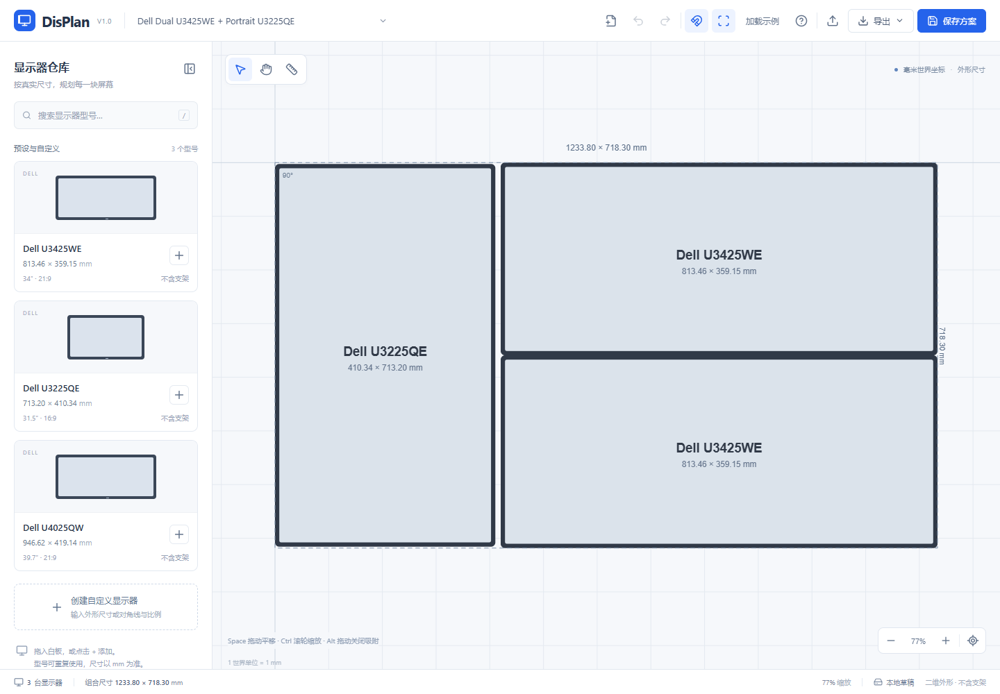

# DisPlan — Display Layout Planner

**一个基于真实物理尺寸的显示器布局规划工具。**

DisPlan 在浏览器中以毫米规划多屏组合：添加显示器、自由排列、自动吸附、精确测量、查看组合尺寸，并在本地保存方案。无需后端、账号或外部数据库。



## 安装与运行

需要 Node.js **22.12+ 或 24 LTS**。推荐 Node.js 24，并使用项目锁文件安装依赖。

```bash
npm ci
npm run dev
```

打开终端显示的本地地址，默认为 `http://127.0.0.1:5173/`。

```bash
npm run typecheck    # TypeScript 检查
npm test            # Vitest 单元测试
npm run build       # 类型检查与生产构建
npm run preview     # 预览 dist/ 产物
npm run test:e2e    # Playwright 浏览器测试
```

浏览器测试默认使用已安装的 Microsoft Edge。如需 Chromium，可在 `playwright.config.ts` 中移除 `channel: 'msedge'`，然后执行 `npx playwright install chromium`。测试会自动启动本地服务；已存在同端口服务时复用。

构建后的 `dist/` 可部署到普通静态服务器。应用不访问产品图片、字体 CDN 或外部数据接口。首次安装依赖需要联网。

支持通过局域网普通 HTTP 地址（如 `http://192.168.30.141/`）访问，需由服务器在对应地址和端口提供 `dist/` 静态文件。UUID 创建优先使用 `crypto.randomUUID()`；HTTP 非安全上下文下使用 `crypto.getRandomValues()` 生成同格式的 UUID v4，无需 HTTPS 才能创建方案、添加或复制显示器。浏览器须支持 Web Crypto。不同协议、主机或端口的 localStorage 相互独立，迁移已有方案请使用 JSON 导出 / 导入。

## 页面功能

- **显示器仓库**：搜索预设型号，拖入白板或点击 +；同一型号可重复添加。自定义型号支持直接输入外形尺寸，或按对角线、比例与边框估算后手动修正。
- **无限白板**：自由平移、缩放、Fit、多选、移动、复制、删除、锁定与围绕中心旋转。预设尺寸始终只读；自定义尺寸通过数值字段修改。
- **吸附**：独立切换边缘、中心线和 0 / 5 / 10 / 20 mm 间距，显示动态参考线。间距候选要求另一轴投影重叠。
- **Measure**：依次点击 A、B，查看轴向间距、投影重叠、中心偏差、中心距离、最短距离及四边对齐偏差。多选后可将所选对象设为临时测量组，采用联合 AABB。拖动与旋转会实时更新结果。
- **组合包围盒**：虚线及尺寸标注可切换；底部总宽高始终更新，包含锁定对象。
- **方案管理**：新建、重命名、保存、从方案名称右侧箭头打开本地列表、切换与删除。JSON 可导入继续编辑，PNG / SVG 默认导出纯布局图形。
- **历史记录**：添加、删除、拖动、坐标与尺寸修改、旋转、复制、锁定可撤销重做，单次拖动只记一步，最多保留 100 步。平移和缩放不进入历史。

测量组使用方法：先在选择工具下 Shift 多选，切换 Measure，点击“将所选 N 台设为目标 A”；再点击单台 B，或 Shift 多选后点击“设为目标 B”。再次选择目标会开始下一组测量。删除任一目标成员会清除整次临时测量，避免悄悄改变组定义。

## 鼠标与键盘

快捷键仅在白板获得焦点时生效；点击白板或显示器可获得焦点。输入框内不会触发布局快捷键。macOS 可使用 Command 代替 Ctrl。

| 操作                       | 行为                                 |
| -------------------------- | ------------------------------------ |
| 拖入仓库卡片 / +           | 在落点 / 可视中心创建实例            |
| 单击 / Shift + 单击        | 选择 / 多选                          |
| 拖动                       | 移动未锁定的选择，可一次移动多台     |
| Shift + 拖动               | 锁定水平或垂直移动                   |
| Alt + 拖动                 | 临时禁用吸附                         |
| Ctrl + 滚轮                | 围绕指针缩放画布，阻止浏览器页面缩放 |
| 滚轮 / 平移工具 / 中键拖动 | 平移白板                             |
| Space + 拖动               | 临时平移                             |
| R                          | 旋转所选对象 90°                     |
| 方向键 / Shift + 方向键    | 移动 1 mm / 10 mm                    |
| Ctrl + D                   | 复制，偏移 20 mm                     |
| Delete / Backspace         | 删除未锁定的所选对象                 |
| Ctrl + Z / Ctrl + Y        | 撤销 / 重做                          |
| Ctrl + Shift + Z           | 重做                                 |
| Escape                     | 取消选择、清除测量并退出当前工具     |

## 物理尺寸与缩放

唯一逻辑单位为 **mm**。实例位置是外形矩形的中心坐标，X 向右、Y 向下。所有几何计算来自型号与实例数据，独立于 Konva 描边、文字和像素边界。

```text
screenX = xMm × pixelsPerMm + panX
screenY = yMm × pixelsPerMm + panY
```

100% 缩放表示 1 CSS px/mm，**不代表实际屏幕上的尺长校准**。视图缩放上限为 800%，下界为 0.000001%，Fit 可显示远距离分布的对象，缩放不会修改物理尺寸或坐标。旋转 90° / 270° 交换外形宽高，保持中心不变。计算过程保留浮点精度，界面默认显示两位小数。

吸附阈值为 8 CSS px，对应世界阈值 `8 / pixelsPerMm` mm；X / Y 独立选择最近有效候选。Shift 轴向限制同时限制吸附轴。多选拖动以可移动对象的联合包围盒吸附。

矩形投影重叠时，轴向间距为 0，另列重叠长度；矩形最短欧氏距离为 `hypot(xGap, yGap)`。偏差统一采用 B − A。测量组和整体组合均使用外形的最小轴对齐包围盒。

预设不含支架外形尺寸：

| 型号         | 宽度 (mm) | 高度 (mm) |
| ------------ | --------: | --------: |
| Dell U3425WE |    813.46 |    359.15 |
| Dell U3225QE |    713.20 |    410.34 |
| Dell U4025QW |    946.62 |    419.14 |

预设外形尺寸按本项目输入规范固定。对角线、分辨率、比例仅用于辅助标识，几何计算以宽高为准。

内置 **Dell Dual U3425WE + Portrait U3225QE** 示例：右侧两台 U3425WE 上下零间距，左侧竖置 U3225QE 与双屏组合垂直居中，水平间距 10 mm。回归期望为：双屏高度 718.30 mm、竖屏高度 713.20 mm、高度差 5.10 mm、顶底偏差绝对值各 2.55 mm、组合 1233.80 × 718.30 mm。

## 数据格式与本地保存

JSON 是自包含的 V1 文档；随文件保存所有所需型号定义。导入时保留文件内型号尺寸，不用当前仓库规格覆盖历史布局。

```json
{
  "schemaVersion": 1,
  "id": "layout-id",
  "name": "我的方案",
  "specs": [
    {
      "id": "model-id",
      "name": "自定义显示器",
      "widthMm": 600,
      "heightMm": 340,
      "isCustom": true
    }
  ],
  "instances": [
    {
      "id": "instance-id",
      "specId": "model-id",
      "xMm": 0,
      "yMm": 0,
      "rotation": 0,
      "locked": false
    }
  ]
}
```

`MonitorSpec` 可扩展有效显示区域、标称对角线、分辨率、比例与 `estimated` 字段；`MonitorInstance` 的 `widthMm` / `heightMm` 覆盖只允许自定义型号。旋转仅允许 0、90、180、270。导入拒绝未知版本、重复 ID、缺失型号引用、非法数字与预设尺寸覆盖。导出不保存测量结果、选择、网格或视图状态。

localStorage 使用 `displan.layouts.v1` 保存命名方案、`displan.draft.v1` 自动保存当前草稿（500 ms 防抖）、`displan.custom.v1` 保存自定义仓库。点击保存会即时写入草稿，离开页面时也会尝试刷新草稿。刷新恢复当前草稿。新建、切换和加载示例替换当前草稿，需保留时先保存命名方案或导出 JSON。损坏的草稿不会在首次打开时被自动覆盖；用户开始编辑后可重新保存。

## 项目结构

```text
src/
  components/       仓库、自定义编辑器、工具栏、Konva 白板及浮动面板
  data/presets.ts   内置型号、空方案与 Dell 示例
  domain/          纯几何、坐标变换、测量、吸附与类型定义
  state/           Zustand 文档历史与临时编辑器状态
  services/        JSON 校验、本地存储、SVG / PNG 导出
tests/             Playwright 交互测试
docs/              验证报告与界面截图
```

## 限制与验证边界

- 桌面鼠标与键盘优先，最低目标宽度 1100 px；窄屏默认折叠仓库。尚未实现触摸拖动和移动端手势。
- 无 3D、曲面、支架、承重或碰撞建模。示意边框不是产品真实边框；零间距几何不等于机械安装可行。
- 单型号宽高允许 0.01–10000 mm，中心坐标允许 ±10000000 mm；导入最多 10000 型号及实例、10 MB。这是输入保护范围，未承诺万台实例的交互性能。
- PNG 最长边限制为 4096 px，保持比例；SVG 保存 mm 尺寸及几何 viewBox。两种导出只含显示器、型号和外形尺寸文本，留白为 30 mm，不含测量线或组合虚线。
- 本地数据与浏览器及站点地址绑定；清理浏览器数据会删除方案。隐私模式、存储配额或权限可能导致本地保存失败，界面会提示。重要方案请导出 JSON。
- 已执行验证见 [验证报告](docs/VALIDATION.md)。当前浏览器自动化覆盖 Chromium 内核的 Microsoft Edge，其他浏览器未逐一验证。

实现参考：[Vite 文档](https://vite.dev/guide/)、[Konva React 拖动](https://konvajs.org/docs/react/Drag_And_Drop.html)、[Konva 指针中心缩放](https://konvajs.org/docs/sandbox/Zooming_Relative_To_Pointer.html)。
